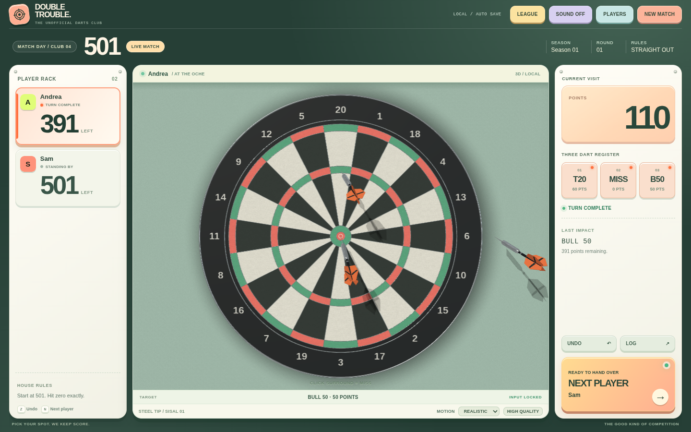

# Double Trouble Darts

**V4.1 / Soft Sport**, an offline darts club app with a 3D scoring board, player profiles, match history, leagues, achievements and performance statistics.

The native macOS wrapper uses Swift + WebKit. The scoring app itself is local HTML/CSS/JavaScript. No account, external server or telemetry is required.

## Download

Download `Double-Trouble-Darts-v4.1-Mac-Source-Installer.zip` from [GitHub Releases](https://github.com/Chiesu/double-trouble-darts/releases/latest).

This is a macOS source-build installer, not a precompiled or notarized application.

1. Extract the downloaded ZIP.
2. Open Terminal, navigate into the extracted folder, and run `zsh ./Install-or-Update.command`.
3. Install Apple Command Line Tools if prompted.
4. The script builds and installs the app in `~/Applications`.

Existing player and club data is stored separately in `~/Library/Application Support/Double Trouble Darts/`. Back up this data before updating.

**Option A: macOS app ZIP (CI build)**

Unzip `Double-Trouble-Darts-v4.1.0-macOS.zip`, move **Double Trouble Darts.app** into your Applications folder, and launch it. This build is ad-hoc-signed, **not Developer ID signed or notarized**. macOS Gatekeeper may block it. Only bypass security warnings after independently verifying the source and that the download is from the intended project. A properly signed/notarized download requires an Apple Developer ID.

**Option B: build on your own Mac (recommended for the first public release)**

1. Download `Double-Trouble-Darts-v4.1.0-source-build.zip` from Releases.
2. Extract it, quit any running Double Trouble Darts app, and run `Install-or-Update.command` on macOS.
3. If prompted for developer tools, run `xcode-select --install`, then repeat the command.
4. The script compiles the app locally, ad-hoc-signs it, and installs it to `~/Applications/Double Trouble Darts.app`.
5. A backup of existing club data is made before replacing the old app.

**Existing club data:** `~/Library/Application Support/Double Trouble Darts/club.json`. Updates should not delete this folder. Back up your club data independently before experimenting with prereleases.

## Browser preview

Open `Web/index.html` in Chromium or another recent desktop browser. Browser preview data is not the same storage as the native app.

## Key features

- 301, 501, Cricket, Count Up, and flexible player rosters.
- Click-to-score interactive 3D board, throw feedback, and 2D fallback.
- Player avatars and customizable darts.
- League, rivalries, achievements, personal statistics and recent results.
- Undo, autosave, and manual club-data backup/restore.
- Layout tested previously down to compact desktop widths; phone-sized browser view is a preview, not a native iPhone app.

## Source tree

- `Web/`: offline UI, gameplay state and 3D renderer.
- `Mac/`: native Swift/WebKit wrapper and bundle metadata.
- `Assets/`: original app icon supplied with the project.
- `Tests/test_v4.py`: Playwright browser integration suite.
- `VALIDATION-NOTES.md`: fresh static checks and the partial browser rerun status.
- `Install-or-Update.command`: source-build **and install** on a Mac, with existing-data backup.
- `scripts/build-macos.sh`: source-build only; creates `dist/Double Trouble Darts.app`.
- `.github/workflows/release-macos.yml`: on Git tag, builds and attaches an ad-hoc-signed app ZIP to GitHub Releases.

## Development

On a Mac, use `./scripts/build-macos.sh` to generate the bundle without replacing an installed app. For browser QA, install Python Playwright and its Chromium dependency and run `python Tests/test_v4.py`; see `TEST-REPORT.md` for the prior baseline and `VALIDATION-NOTES.md` for this preparation's partial rerun. The native app has **not** been built or tested in the environment used to prepare this repository.

## Privacy and release status

All club data is local. Uploaded player photos are stored with club data and must never be committed to this public repository. Third-party artwork and external assets should be reviewed separately before publishing.

This is an experimental/open-source release. The workflow's macOS archive is not Apple-notarized; do not describe it as a frictionless installer.

## License

MIT for the source code in this repository. See [LICENSE](LICENSE). Media assets are covered only to the extent the publisher owns or is authorized to distribute them.
